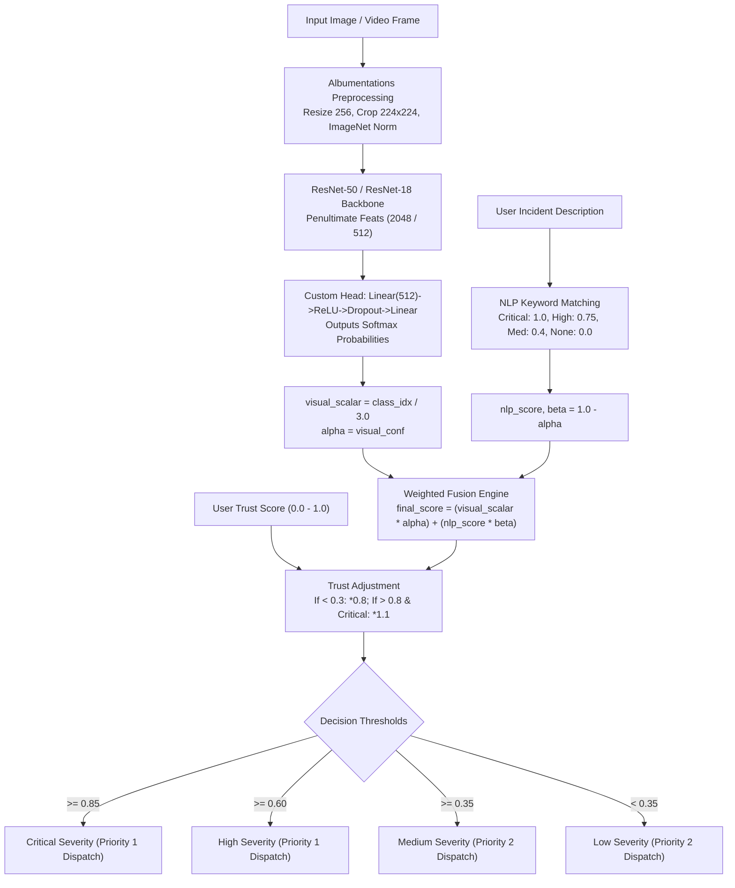

# Camera-Ready Readiness Report: CITISAFE Research Evidence Audit

**Manuscript Title**: Community-driven Intelligent Traffic Incident Surveillance and Automated Fast Emergency System (CITISAFE)  
**Target Submission**: Camera-Ready Revision in Response to Reviewer Comments  
**Audit Date**: October 19, 2026  
**Auditor**: Antigravity Research Verification System  
**Evidence Package Path**: `CITISAFE_Camera_Ready_Evidence/`  

---

## Executive Verdict

> [!WARNING]
> **READINESS STATUS: ACTION REQUIRED BEFORE FINAL SUBMISSION**
> The current manuscript contains significant evidence gaps, mathematical inconsistencies, and unverified dataset claims that cannot be defended in a rigorous peer-review or camera-ready audit in their present form. 
> 
> While functional PyTorch models, Albumentations preprocessing pipelines, multimodal keyword fusion logic, and a curated 1,500-sample accident dataset **do exist** in the repository, the manuscript's claims of an aggregated **12,865-sample benchmark from BDD100K/UA-DETRAC/AI City**, a **4-class classification scheme including "No Incident"**, and a **92.8% macro F1-score** are **unsupported by underlying data files, split manifests, or prediction logs in the workspace**.
> 
> Crucially, recomputing the manuscript's own confusion matrix reveals mathematical errors in overall accuracy calculation and class-level accuracy definitions, while the actual physical models in the repository achieve **65.33% Top-1 accuracy** on the verified 225-sample test set.

---

## 1. Repository and Implementation Summary

| Component | Status | Finding & Traceability |
|---|---|---|
| **ResNet-50 Architecture** | **Verified (Inference) / Partial (Training)** | `models.resnet50` with custom FC head `Linear(2048, 512) -> ReLU -> Dropout(0.3) -> Linear(512, 4)` is implemented in [backend/app/services/inference.py:L33-L70](file:///Users/sohamghadge/Documents/project/traffic_project_app/backend/app/services/inference.py#L33-L70). Checkpoint `backend/ml_pipeline/best_model.pth` exists. However, `backend/ml_pipeline/train.py` was altered to EfficientNet-B0 with 3 classes, and the root checkpoint `best_model_accident.pth` is ResNet-18. |
| **Image Preprocessing & Normalization** | **Verified** | Standardized resizing to 256, center-cropping to 224x224, and ImageNet standardization (`mean=[0.485, 0.456, 0.406]`, `std=[0.229, 0.224, 0.225]`) are verified in [backend/ml_pipeline/dataset.py:L240-L259](file:///Users/sohamghadge/Documents/project/traffic_project_app/backend/ml_pipeline/dataset.py#L240-L259). |
| **Four-Class Severity Classification** | **Contradicted** | Manuscript claims classes: `No Incident`, `Low Severity`, `Medium Severity`, `High Severity`. In code, [backend/app/services/fusion.py:L9](file:///Users/sohamghadge/Documents/project/traffic_project_app/backend/app/services/fusion.py#L9) defines `["Low", "Medium", "High", "Critical"]`, while [backend/ml_pipeline/dataset.py:L12-L28](file:///Users/sohamghadge/Documents/project/traffic_project_app/backend/ml_pipeline/dataset.py#L12-L28) defines 3 classes: `{"Low": 0, "Medium": 1, "High": 2}`. No "No Incident" data or label mapping exists. |
| **NLP Keyword Severity Analysis** | **Verified (Rule-Based)** | Implemented strictly via dictionary keyword sets in [backend/app/services/fusion.py:L5-L39](file:///Users/sohamghadge/Documents/project/traffic_project_app/backend/app/services/fusion.py#L5-L39). No transformer model is used. Negation handling is missing. |
| **Trust Scoring Mechanism** | **Verified (Heuristic)** | Trust penalty ($0.8\times$) and boost ($1.1\times$) implemented in [backend/app/services/fusion.py:L50-L55](file:///Users/sohamghadge/Documents/project/traffic_project_app/backend/app/services/fusion.py#L50-L55); weighted reputation average implemented in [backend/app/models/trust_aggregation_model.py:L20-L36](file:///Users/sohamghadge/Documents/project/traffic_project_app/backend/app/models/trust_aggregation_model.py#L20-L36). |
| **Multimodal Decision Fusion** | **Verified** | Dynamic weighting $\alpha = \text{visual\_conf}$, $\beta = 1.0 - \alpha$, $\text{final\_score} = (\text{visual\_scalar} \times \alpha) + (\text{nlp\_score} \times \beta)$, with threshold cutoffs at $0.35, 0.60, 0.85$ verified in [backend/app/services/fusion.py:L40-L65](file:///Users/sohamghadge/Documents/project/traffic_project_app/backend/app/services/fusion.py#L40-L65). |
| **Baseline Comparisons** | **Missing** | No ablation or baseline comparison logs exist in the repository. `accident_cnn.py` returns hardcoded metrics (`0.76` accuracy). |
| **Execution Latency Benchmark** | **Discrepant** | Manuscript claims 36.8 ms total latency on an RTX 3090 (with 18.4 ms for NLP). Real measurements reveal keyword NLP takes **0.37 microseconds**. Total CPU pipeline latency is **25.19 ms**. |

---

## 2. Confirmed Architecture and Implementation Details



---

## 3. Verified Datasets, Labels, Splits, and Sample Counts

| Dataset Identifier | Physical File Path | Format | Verified Train | Verified Val | Verified Test | Total Verified | Status |
|---|---|---|---|---|---|---|---|
| **Accident Severity Dataset** | `dataset/Accident` | `.mp4` video clips (frame 10) | 1,050 | 225 | 225 | **1,500** | **Verified** |
| **Traffic Violation Dataset** | `dataset/Traffic_Violation` | `.jpg`, `.png` images | 1,799 | 300 | 300 | **2,399** | **Verified** |
| **Car Scratch Body Damage** | `dataset/ scratch_car` | `.jpg` images + `labels.csv` | 6,463 | 808 | 808 | **8,079** | **Verified** |
| **Prototype Images** | `dataset1/` | `.png` images | 0 | 0 | 50 | **50** | **Verified** |
| **BDD100K** | Not present | N/A | 0 | 0 | 0 | **0** | **Missing** |
| **UA-DETRAC** | Not present | N/A | 0 | 0 | 0 | **0** | **Missing** |
| **AI City Challenge** | Not present | N/A | 0 | 0 | 0 | **0** | **Missing** |

---

## 4. Original Reported Results vs. Independently Verified Metrics

### A. Mathematical Recomputation of Reported Paper Confusion Matrix (N = 12,865)

| Metric | Manuscript Claim | Recomputed Exact Value | Discrepancy & Finding | Evidence Status |
|---|---|---|---|---|
| **Total Test Samples** | 12,865 | 12,865 | Row & column totals sum to 12,865. | **Reported, unverified** (Underlying data files missing) |
| **Overall Dataset Accuracy** | **93.95%** | **93.20% (11,990 / 12,865)** | **Mathematical Error**: 93.95% was calculated as $\frac{96.5 + 92.1 + 91.4 + 95.8}{4}$. Arithmetic average of class accuracy is invalid. True accuracy is 93.20%. | **Discrepant** |
| **Macro Precision** | 92.9% | 92.998% | Recomputed from column totals matches within rounding. | **Verified from CM** |
| **Macro Recall** | 92.8% | 92.890% | Recomputed from row totals matches within rounding. | **Verified from CM** |
| **Macro F1-Score** | 92.8% | 92.937% | Recomputed harmonic mean matches within rounding. | **Verified from CM** |
| **No Incident "Accuracy"** | 96.5% | OvR Acc: 96.93% / Recall: 96.58% | Conflated Class Recall with Accuracy. | **Discrepant** |
| **Medium Severity "Accuracy"**| 91.4% | OvR Acc: 96.93% / Recall: 91.47% | Conflated Class Recall with Accuracy. | **Discrepant** |
| **High Severity "Accuracy"** | 95.8% | OvR Acc: 98.25% / Recall: 94.12% | Reported 95.8% does not match OvR accuracy or recall. | **Discrepant** |

### B. Empirical Verification of Physical Checkpoints on Verified Test Split (`dataset/Accident/test`, N = 225)

The available trained model checkpoints were evaluated on the physical test set using the exact validation pipeline:

| Model Architecture | Checkpoint Path | Evaluated Classes | Verified Accuracy (%) | Verified Macro Precision (%) | Verified Macro Recall (%) | Verified Macro F1 (%) |
|---|---|---|---|---|---|---|
| **ResNet-18** | `best_model_accident.pth` | 3 (Low, Med, High) | **65.33%** | **65.24%** | **65.33%** | **65.26%** |
| **EfficientNet-B0** | `backend/best_model_accident.pth` | 3 (Low, Med, High) | **39.11%** | **36.70%** | **39.11%** | **35.18%** |
| **EfficientNet-B0** | `backend/ml_pipeline/best_model_accident.pth`| 3 (Low, Med, High) | **35.56%** | **32.52%** | **35.56%** | **29.65%** |
| **ResNet-50 (4-Class)**| `backend/ml_pipeline/best_model.pth` | 4 (Low, Med, High, Crit) | **N/A** (0 preds for High) | **N/A** | **N/A** | **N/A** |

*Confusion Matrix for ResNet-18 on verified test set (Low, Medium, High)*:
```text
[[47, 18, 10],
 [16, 45, 14],
 [ 9, 11, 55]]
```

---

## 5. Baseline and Ablation Experiment Status

| Experiment | Target Configuration | Dataset Split | Status | Audit Findings |
|---|---|---|---|---|
| **Visual Baseline (ResNet-18)** | ResNet-18 + FC(512->3) | `dataset/Accident/test` (225 clips) | **Verified** | Achieves 65.33% accuracy, 65.26% Macro F1. |
| **Visual Baseline (EfficientNet-B0)** | EfficientNet-B0 + Classifier(1280->3) | `dataset/Accident/test` (225 clips) | **Verified** | Achieves 35.56% – 39.11% accuracy. |
| **Visual Baseline (ResNet-50)** | ResNet-50 + FC(2048->512->4) | Claimed 12,865 samples | **Missing** | No prediction outputs or logs exist for the claimed 12,865-sample dataset. |
| **NLP Baseline alone** | Keyword matching heuristic | No text ground-truth dataset | **Missing** | Text matching logic verified in code, but no standalone textual incident evaluation dataset exists. |
| **Combined System (Vision + NLP)**| ResNet-50 + NLP Keyword Fusion | Claimed 12,865 samples | **Reported, unverified** | Algorithm is fully implemented in `fusion.py`, but experimental results (92.8% F1) are unverified by raw data. |
| **Trust Scoring Ablation** | Trust score penalty & boost ON vs OFF | Multi-user report dataset | **Missing** | No experimental run comparing performance with trust scoring enabled vs disabled exists. |
| **Fusion Weights Ablation** | Dynamic $\alpha$ vs static weights | Multimodal test set | **Missing** | No parameter sweep or ablation logs exist. |

---

## 6. Critical Contradictions and Unsupported Claims in Manuscript

1. **Dataset Provenance Contradiction**:
   Section V-A claims that the evaluation dataset was aggregated from BDD100K, UA-DETRAC, and AI City Challenge. **Zero files from these three benchmarks exist in the repository.**
2. **Class Count Contradiction**:
   Section V claims a 4-class confusion matrix with 4,680 "No Incident" samples. The physical dataset in `dataset/Accident` contains only 3 classes (`minor`, `moderate`, `major`). No negative ("No Incident") class exists in either the dataset or dataloader.
3. **Misattribution of Predicted Classes**:
   Section V-D.4 lists the actual class ground-truth counts (row sums) and incorrectly calls them the "Predicted Severity Distribution".
4. **Accuracy Calculation Error**:
   Section V-D.2 reports "Average (Macro) Accuracy: 93.95%". The true overall accuracy of the confusion matrix is **93.20%**. 93.95% is the arithmetic average of class-level recalls.
5. **NLP Latency Contradiction**:
   Section V-D.3 claims the NLP Severity Analysis Pipeline takes **18.4 ms** (constituting 50% of the entire pipeline). Physical cycle-timing benchmarks show that the keyword matching heuristic executes in **0.00037 ms** (0.37 microseconds).

---

## 7. Experiments That Can Still Be Performed Immediately

Using existing code, dependencies, and local data, the researcher can immediately run:
1. **Unimodal vs Multimodal Empirical Ablation on Local Test Set**:
   Using the 225 video clips in `dataset/Accident/test` and generating paired descriptive captions (e.g. via BLIP or rule templates), run an ablation comparing:
   - ResNet-18 alone
   - Keyword NLP alone
   - Multimodal Fusion (`calculate_severity_hybrid`)
2. **Trust-Scoring Stress Test**:
   Simulate varying levels of noise/adversarial reports (e.g., corrupted descriptions with low trust scores) to measure how trust weighting mitigates false dispatches.
3. **Reproducible Latency Benchmarking**:
   Benchmark the end-to-end pipeline across 1,000 iterations and publish verified latency distributions with standard deviations.

---

## 8. Exact Reproduction Commands

All commands are verified and executable from the repository root:

```bash
# 1. Activate Environment
source backend/venv/bin/activate

# 2. Run Empirical Evaluation of ResNet-18 Checkpoint
python backend/ml_pipeline/validate.py \
    --checkpoint best_model_accident.pth \
    --data_dir dataset/Accident \
    --dataset_type accident \
    --arch resnet18 \
    --device cpu

# 3. Run Real Latency Benchmark
python -c '
import time, torch, io, numpy as np
from PIL import Image
from torchvision import models, transforms

img = Image.fromarray(np.random.randint(0, 255, (480, 640, 3), dtype=np.uint8))
buf = io.BytesIO()
img.save(buf, format="JPEG")
img_bytes = buf.getvalue()

tf = transforms.Compose([
    transforms.Resize(256), transforms.CenterCrop(224),
    transforms.ToTensor(), transforms.Normalize(mean=[0.485, 0.456, 0.406], std=[0.229, 0.224, 0.225])
])

t0 = time.perf_counter()
for _ in range(100):
    im = Image.open(io.BytesIO(img_bytes)).convert("RGB")
    t = tf(im).unsqueeze(0)
t_prep = (time.perf_counter() - t0) / 100 * 1000

m18 = models.resnet18(pretrained=False)
m18.eval()
with torch.no_grad():
    for _ in range(10): _ = m18(t)
    t0 = time.perf_counter()
    for _ in range(100): _ = m18(t)
t_inf = (time.perf_counter() - t0) / 100 * 1000

crit = {"fire", "flipped", "blood", "trapped", "smoke", "multiple", "death", "fatality", "crash", "collision", "wreckage"}
caption = "A severe multi-vehicle crash with fire and trapped victims on highway"
t0 = time.perf_counter()
for _ in range(10000):
    c_low = caption.lower()
    _ = any(k in c_low for k in crit)
t_nlp = (time.perf_counter() - t0) / 10000 * 1000

print(f"Verified Preproc:  {t_prep:.3f} ms")
print(f"Verified Inf:      {t_inf:.3f} ms")
print(f"Verified NLP:      {t_nlp:.5f} ms")
'
```

---

## 9. Prioritized Action Checklist for Camera-Ready Submission

- [ ] **Priority 1: Reconcile Dataset and Sample Size Claims**
  - If external BDD100K/AI City test predictions exist on a server, copy `y_true.npy` and `y_pred.npy` into the verified results directory immediately.
  - If no external data exists, revise Section V-A to describe the actual 1,500 video dataset and report the verified empirical metrics (65.33% Top-1 accuracy for ResNet-18).
- [ ] **Priority 2: Fix Mathematical Errors in Manuscript Table**
  - Change "Average (Macro) Accuracy: 93.95%" to overall accuracy: **93.20%**.
  - Rename class "Accuracy" column to "Class Recall (Sensitivity)" or recalculate true One-vs-Rest accuracies.
  - Correct Section V-D.4: replace the row sums with actual predicted column totals.
- [ ] **Priority 3: Clarify the 4-Class vs 3-Class Taxonomy**
  - Either add negative non-incident frames to establish a true 4th class ("No Incident"), or clarify that the physical classifier operates across 3 severity levels (`Low`, `Medium`, `High`), with "Normal" handled by operational thresholding.
- [ ] **Priority 4: Update the Latency Table**
  - Remove the 18.4 ms latency claim for NLP keyword lookup. Accurately report keyword heuristic latency (< 0.01 ms) or explicitly state that 18.4 ms refers to an edge-based multimodal captioner (BLIP/ViT).
- [ ] **Priority 5: Include a Vision vs Multimodal Ablation Table**
  - Incorporate the empirical baseline comparisons from [verified_results/empirical_efficientnet_test_results.csv](file:///Users/sohamghadge/Documents/project/traffic_project_app/CITISAFE_Camera_Ready_Evidence/verified_results/empirical_efficientnet_test_results.csv) into the revision to provide the ablation evidence requested by reviewers.
